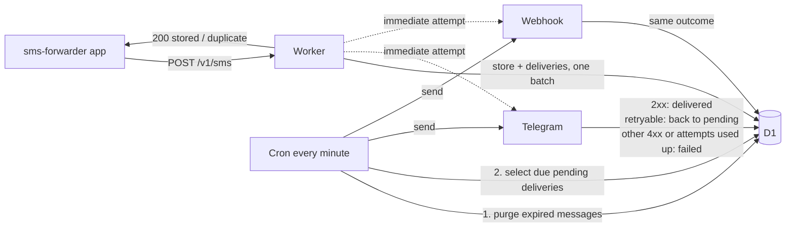

# sms-relay

[](https://github.com/Lacho00/sms-relay/actions/workflows/ci.yml)
[](LICENSE)

[](https://deploy.workers.cloudflare.com/?url=https://github.com/Lacho00/sms-relay)

A small TypeScript backend on Cloudflare Workers. It receives the SMS that the Android app
`sms-forwarder` sends, stores each one once in D1, and forwards it to Telegram and/or a signed
webhook through a retrying outbox.

- An accepted SMS is stored before the Worker answers 200. A phone retry never creates a second copy.
- Delivery to each destination is at-least-once, with exponential backoff and a visible final state.
- Logs never contain an SMS body, a sender, a token or a chat id.
- Runtime dependencies: Hono, Zod and Drizzle only. Configuration is env vars and secrets only.

## How it works



On ingest the Worker validates the payload, computes a dedup key, and in one D1 batch inserts
the message plus one `pending` delivery per destination that is configured and whose sender
filter matches. After answering 200 it tries those deliveries once. Every minute the cron applies
retention, then retries up to 50 due deliveries (5 at a time). A delivery is claimed with a
60-second lease, so the immediate attempt and the cron never send the same row at the same time.

Retry rules for a destination response:

- 2xx: `delivered`.
- 408, 425, 429, 5xx, a 10 s timeout or a network error: retry. After failed attempt `n` the next
  one is at `min(60 s * 2^(n-1), 1 h)`, so 1, 2, 4, 8, 16, 32 min, then 1 h. A `Retry-After`
  header (or Telegram's `retry_after`) raises the wait if it is larger, still capped at 1 h.
- 3xx: `failed` with `last_error = redirect`. Redirects are never followed.
- Any other 4xx: `failed` at once.
- After `MAX_ATTEMPTS` attempts (default 10, about 4 h in total): `failed`.

## API

All error bodies are `{"error": "<code>", "message": "<text>"}`. The Worker never returns a 3xx.
A path or method that is not listed below returns `404 {"error":"not_found"}`.

| Method | Path | Auth | Purpose |
|---|---|---|---|
| POST | `/v1/sms` | `INGEST_TOKEN` | Ingest one SMS |
| GET | `/v1/messages` | `READ_TOKEN` | List messages, newest first |
| GET | `/v1/messages/:id` | `READ_TOKEN` | One message with its deliveries |
| GET | `/health` | none | `{"status":"ok"}` |

Auth is `Authorization: Bearer <token>`. Tokens are compared in constant time.

### POST /v1/sms

```json
{ "sender": "+15551234567", "body": "Your code is 123456", "received_at": 1762697001000 }
```

| Field | Rule |
|---|---|
| `sender` | string, trimmed, 1-64 characters, not empty once whitespace is removed |
| `body` | string, 1-10 000 characters |
| `received_at` | epoch ms (integer or digit string) or ISO 8601 with `Z` or an offset. ISO without a zone is rejected. Must be between 2000-01-01 and now + 24 h |
| `sim` | optional: integer 0-15, a digit string of the same, `null` or `""` |
| `device` | optional string, up to 64 characters |

Unknown keys are ignored. The body is read as JSON whatever the `Content-Type`.

Checks run in this order, and the first one that fails answers:

| Status | `error` | When |
|---|---|---|
| 503 | `config_invalid` | A destination is half configured, or a variable is invalid (for example a regex that does not compile) |
| 503 | `not_configured` | `INGEST_TOKEN` is missing or shorter than 32 characters |
| 401 | `unauthorized` | Missing or wrong bearer token |
| 400 | `payload_too_large` | Body over 64 KiB, measured on the bytes read |
| 400 | `invalid_json` | Body is not valid JSON |
| 400 | `validation_failed` | A field is invalid. `message` names the fields, never their values |
| 200 | - | `{"status":"stored","id":<n>}` for a new SMS |
| 200 | - | `{"status":"duplicate","id":<n>}` for an SMS already stored. No new deliveries are created |
| 500 | `internal` | Unexpected error, for example D1 is unavailable |

Success is always exactly 200. Why 503 for configuration problems: the app keeps the SMS and
retries on a 503, so nothing is lost once you fix the config. A 401 or 400 would make the app drop it.
Why 400 for an oversized body: a 413 is not terminal for the app, so it would retry a request that
can never succeed.

### GET /v1/messages

Query: `limit` (integer 1-100, default 50) and `cursor` (opaque, taken from `next_cursor`).
Newest first.

```json
{
  "messages": [
    {
      "id": 7, "sender": "+15551234567", "body": "...",
      "received_at": "2025-11-09T14:03:21.000Z", "sim": 1, "device": "Pixel 6",
      "created_at": "2025-11-09T14:03:22.000Z",
      "deliveries": [{ "destination": "telegram", "status": "delivered" }]
    }
  ],
  "next_cursor": "Ng"
}
```

`next_cursor` is `null` on the last page.

### GET /v1/messages/:id

The message fields above plus full deliveries: `destination`, `status` (`pending`, `delivered`
or `failed`), `attempts`, `last_error`, `last_status_code`, `next_attempt_at`, `delivered_at`.
A destination whose sender filter did not match has no delivery row and does not appear.

### Read API errors

| Status | `error` | When |
|---|---|---|
| 503 | `config_invalid` | Same as on ingest |
| 503 | `not_configured` | `READ_TOKEN` is missing, shorter than 32 characters, or equal to `INGEST_TOKEN` |
| 401 | `unauthorized` | Missing or wrong bearer token |
| 400 | `validation_failed` | Bad `limit` or `cursor` |
| 404 | `not_found` | Unknown or non-numeric id |
| 500 | `internal` | Unexpected error |

## Connect sms-forwarder

In the app, set the server URL to `https://<your-worker>.workers.dev/v1/sms` and the token to
your `INGEST_TOKEN`. Run the connection test: the app sends `{}`, and a 400 means "OK" (the
payload is rejected, which proves the URL and token work). A 401 means the token is wrong.

While the server is not configured the Worker answers 503, so the connection test shows
"unreachable" instead of "OK". Finish the configuration below and test again.

## Deploy

### One click

Use the Deploy to Cloudflare button at the top. It creates the D1 database and asks for the
secrets listed in `.dev.vars.example`.

### With wrangler

Requires Node 24 or newer.

```sh
npm ci
npx wrangler d1 create sms-relay
```

Copy the `database_id` it prints into `wrangler.jsonc`, then:

```sh
npx wrangler d1 migrations apply DB --remote
npx wrangler secret put INGEST_TOKEN
npx wrangler secret put READ_TOKEN
# Optional destinations:
npx wrangler secret put TELEGRAM_BOT_TOKEN
npx wrangler secret put WEBHOOK_SECRET
npx wrangler deploy
```

Plain vars (`TELEGRAM_CHAT_ID`, `WEBHOOK_URL`, filters, `RETENTION_DAYS`, ...) go in the `vars`
block of `wrangler.jsonc`. `npm run deploy` applies migrations and deploys in one step. For local
development copy `.dev.vars.example` to `.dev.vars` and run `npm run db:migrate:local` and `npm run dev`.

Generate tokens with, for example, `openssl rand -hex 32`. `READ_TOKEN` must differ from
`INGEST_TOKEN`, so a token leaked from the phone cannot open the archive.

## Configuration

| Name | Kind | Default | Notes |
|---|---|---|---|
| `INGEST_TOKEN` | secret | - | Required, at least 32 characters |
| `READ_TOKEN` | secret | - | Required for the read API, at least 32 characters, different from `INGEST_TOKEN` |
| `TELEGRAM_BOT_TOKEN` | secret | - | Telegram is on when this and `TELEGRAM_CHAT_ID` are both set. Only one set is a config error |
| `TELEGRAM_CHAT_ID` | var | - | Numeric id or `@channel` |
| `TELEGRAM_SENDERS`, `TELEGRAM_SENDER_REGEX` | var | - | Sender filter for Telegram |
| `WEBHOOK_URL` | var | - | The webhook is on when this and `WEBHOOK_SECRET` are both set. `https` only, except `http://localhost` and `http://127.0.0.1` |
| `WEBHOOK_SECRET` | secret | - | At least 32 characters |
| `WEBHOOK_SENDERS`, `WEBHOOK_SENDER_REGEX` | var | - | Sender filter for the webhook |
| `RETENTION_DAYS` | var | `30` | Integer >= 0. `0` keeps messages forever |
| `MAX_ATTEMPTS` | var | `10` | Integer 1-50 |
| `DISPLAY_TIMEZONE` | var | `UTC` | IANA name, used in Telegram messages |
| `TELEGRAM_API_BASE` | var | `https://api.telegram.org` | For tests |

Sender filters: `*_SENDERS` is a comma-separated list matched exactly after removing whitespace and
uppercasing. `*_SENDER_REGEX` is a JavaScript regex (flag `i`) tested on the sender as received.
With neither set every sender passes; otherwise a sender passes if it is in the list or matches the
regex. Keep the regex simple. An invalid value makes the Worker answer `503 config_invalid`; logs
name the variable, never its value.

## Webhook

`POST WEBHOOK_URL` with `Content-Type: application/json; charset=utf-8` and this body:

```json
{
  "event": "sms.received",
  "delivery_id": 12,
  "message": {
    "id": 7,
    "sender": "+15551234567",
    "body": "...",
    "received_at": "2025-11-09T14:03:21.000Z",
    "received_at_ms": 1762697001000,
    "sim": 1,
    "device": "Pixel 6"
  }
}
```

Headers: `X-Timestamp` (unix seconds), `X-Delivery-Id`, and `X-Signature: sha256=<hex>`. The signature is
HMAC-SHA256, keyed with `WEBHOOK_SECRET`, over `<X-Timestamp>` + `.` + the raw request body.
Signing the timestamp too lets you reject a captured request that is replayed later. Respond with a
2xx to acknowledge. Delivery is at-least-once, so deduplicate on `X-Delivery-Id`.

### Verify the signature (Node 24)

Verify against the raw body bytes, before any JSON parsing. This script checks a fixed test vector
and prints `valid`:

```js
import { createHmac, timingSafeEqual } from 'node:crypto';

const WINDOW_SECONDS = 300;

export function verifyWebhook({ secret, timestamp, signature, rawBody, nowMs = Date.now() }) {
  const ts = Number(timestamp);
  if (!Number.isInteger(ts)) return false;
  if (Math.abs(Math.floor(nowMs / 1000) - ts) > WINDOW_SECONDS) return false;

  const expected = 'sha256=' + createHmac('sha256', secret).update(`${ts}.${rawBody}`).digest('hex');
  const a = Buffer.from(expected);
  const b = Buffer.from(String(signature));
  return a.length === b.length && timingSafeEqual(a, b);
}

// Test vector. In a real handler pass the X-Timestamp and X-Signature headers, the raw body,
// and leave nowMs unset.
const ok = verifyWebhook({
  secret: 'whsec_test_0123456789abcdef0123456789',
  timestamp: '1762697001',
  signature: 'sha256=79f18f291569015e1599f13b7895bf0a385165d879d1e47509c73cb0db600cc0',
  rawBody: '{"event":"sms.received"}',
  nowMs: 1762697001000 + 60_000, // pretend the request arrived one minute after it was signed
});
console.log(ok ? 'valid' : 'invalid');
```

Save it as `verify.mjs` and run `node verify.mjs`.

## Telegram

The Worker calls `sendMessage` as plain text (no parse mode, so an SMS cannot break the formatting) with
link previews disabled, because SMS often carry phishing links. The text is `SMS from <sender>`, the
time in `DISPLAY_TIMEZONE`, then the body, cut to 4 096 characters with a trailing `…`. The full body
is always kept in D1.

## Retention

The cron deletes messages (and their deliveries) older than `RETENTION_DAYS`, at most 500 per run.
`RETENTION_DAYS=0` keeps everything. Messages with a pending delivery are kept until the delivery ends.

## Known limits

- Delivery is at-least-once. If a Worker dies in the middle of a send, the lease expires and the
  cron sends again, so Telegram can rarely show a message twice. Deduplicate webhooks on `X-Delivery-Id`.
- The dedup key is deleted with the message. If the phone sends an SMS again after retention purged
  it, it is stored and forwarded again.
- One owner per deployment. There is no multi-user or multi-tenant support.
- Telegram text is cut at 4 096 characters (the stored message is complete).
- The app's onboarding connection test shows "unreachable" while the server is not configured.
- Only one webhook. Destinations are not editable at runtime.
- No rate limiting beyond what Cloudflare provides by default. Ingest needs a token.
- No UI. The read API is the only way to inspect stored messages.

## Development

```sh
npm ci
npm run verify   # tsc --noEmit + vitest with coverage thresholds
```

Tests run in the Workers runtime with a real local D1.

## License

[MIT](LICENSE)
